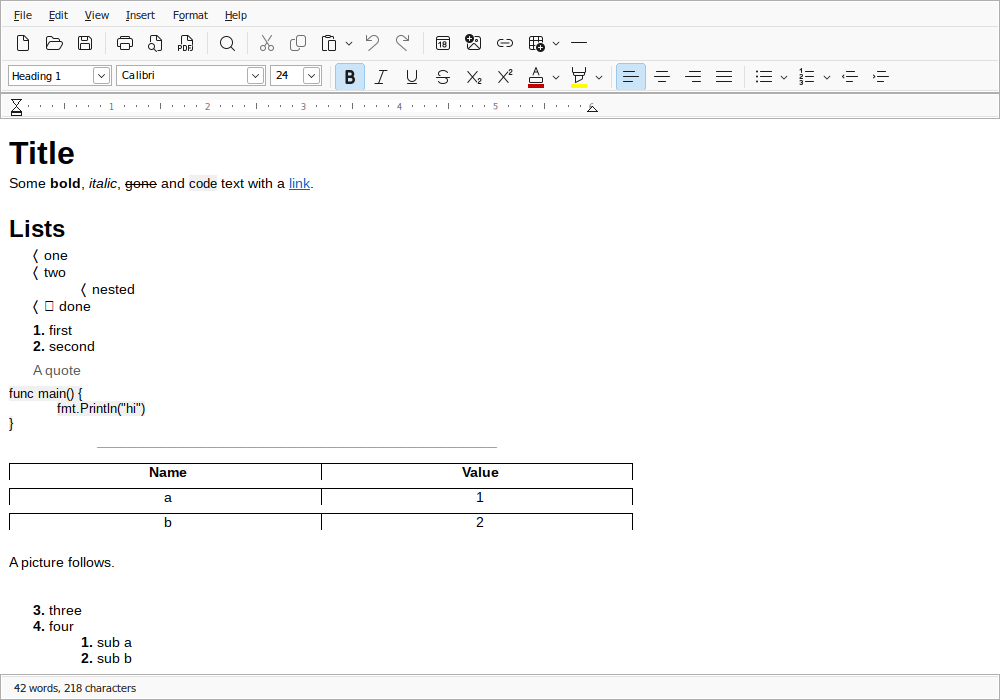
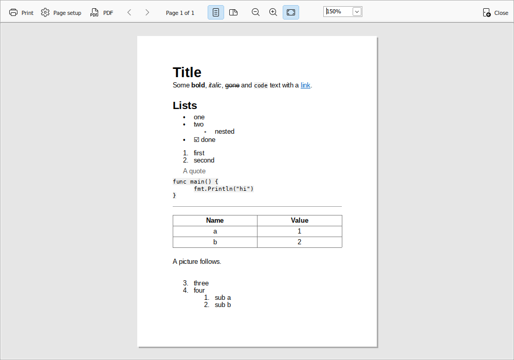

# word4win

A WordPad for Windows, written in Go with
[Windigo](https://github.com/rodrigocfd/windigo). It looks and works like the
classic WordPad: a menu bar, a toolbar, a format bar, the ruler and the same
shortcuts, drawn flat with the Fluent icons of the other 4win apps. Like WordPad it edits rich text (RTF)
in the RichEdit control of Windows. Unlike WordPad it also reads and writes
Markdown and HTML, reads Word (.docx) and LibreOffice (.odt) documents, and
exports PDF. The print preview has a scale. WordPad is gone from Windows
since 24H2; word4win is a small, free replacement.

## Features

- The menus of WordPad: File, Edit, View, Insert, Format and Help (also with
  Alt and the underlined letter, or F10).
- The toolbar: new, open, save, print, print preview, export to PDF, find,
  cut, copy, paste (and paste as text), undo, redo, and insert date and
  time, picture, link, table and horizontal line.
- The format bar: paragraph style, font, size, bold, italic, underline,
  strikethrough, subscript, superscript, text and highlight colour,
  alignment, bullet and numbered lists (with letters and Roman numerals),
  and the indents.
- The View menu has the ruler, the status bar, word wrap (none, to
  the window or to the ruler), the measurement units and the print preview.
  The Format menu has the Font and Paragraph dialogs and line spacing.
- A paragraph style list with Normal, Heading 1 to 6, Quote and Code, which
  are what Markdown and HTML know.
- The ruler shows the text width and the indents of the current paragraph;
  drag the markers to change them.
- The status bar counts words and characters.
- Undo and redo of many steps.
- Find and Replace with match case and whole word.
- Ctrl+click opens a link.
- Recent documents in the File menu, a file dropped on the window opens it.
- Follows the light and dark app mode of Windows (the page stays white).
- Checks for a newer release on request (Help, Check for updates) and
  installs it. Nothing is checked automatically.

## Formats

| Format                       | Open | Save |
| ---------------------------- | ---- | ---- |
| Rich Text Format (.rtf)      | yes  | yes  |
| Markdown (.md)               | yes  | yes  |
| HTML (.html, .htm)           | yes  | yes  |
| Plain text (.txt)            | yes  | yes  |
| Word document (.docx)        | yes  | no   |
| OpenDocument Text (.odt)     | yes  | no   |
| PDF (.pdf)                   | no   | export |

- RTF is the native format: it is read and written by RichEdit itself.
- Markdown is CommonMark with the GitHub tables, strikethrough, task lists
  and bare links. Headings, bold, italic, strikethrough, code, quotes, lists
  (nested, numbered from any number), tables (with column alignment), links,
  pictures and horizontal lines survive a round trip. Pictures are read from
  files next to the document and saved next to it as
  `<name>-<hash>.png`. Fonts, colours, sizes and alignment cannot be
  expressed in Markdown; Save asks before it drops them.
- HTML keeps what Markdown keeps, plus fonts, sizes, colours, highlights,
  alignment and indents. Pictures are embedded as data URLs.
- DOCX and ODT are read with their styles: headings, lists (bullets, numbers,
  letters and Roman numerals), tables (also nested ones), links, pictures
  (PNG, JPEG, GIF, BMP), fonts, sizes, colours, highlights, indents and
  spacing. Headers, footers, footnotes, comments, text boxes and tracked
  deletions are left out. Where Word and LibreOffice differ (such as the
  numbering of lists that continue), word4win reads a document as
  LibreOffice Writer does. Saving goes to RTF,
  Markdown, HTML or text. Old Word documents (.doc) cannot be read.
- PDF export embeds the fonts (as subsets) and the pictures, and keeps the
  links clickable.

## Print preview and scale

File, Print preview (or Ctrl+F2) shows the pages as they print: one
or two pages side by side, zoom in and out or the whole page. The Scale box
shrinks or enlarges the content (10% to 400%) and lays the pages out again,
like the scale of a browser's print dialog. The scale is also in Page setup,
it is remembered, and printing and PDF export use it too.

The preview, the printout and the PDF are laid out by word4win itself, from
the same pages, with the metrics of the installed TrueType fonts, so they
look the same. The line breaks can differ slightly from those in the editor,
which RichEdit lays out.

## Keyboard

| Key                              | Action                          |
| -------------------------------- | ------------------------------- |
| Ctrl+N, Ctrl+Shift+N             | New, new window                 |
| Ctrl+O, Ctrl+S, F12              | Open, save, save as             |
| Ctrl+P, Ctrl+F2                  | Print, print preview            |
| Ctrl+Z, Ctrl+Y                   | Undo, redo                      |
| Ctrl+X, Ctrl+C, Ctrl+V           | Cut, copy, paste                |
| Ctrl+Shift+V                     | Paste as text                   |
| Ctrl+F, F3, Ctrl+H               | Find, find next, replace        |
| Ctrl+B, Ctrl+I, Ctrl+U           | Bold, italic, underline         |
| Ctrl+=, Ctrl+Shift+=             | Subscript, superscript          |
| Ctrl+Shift+>, Ctrl+Shift+<       | Grow font, shrink font          |
| Ctrl+D                           | Font dialog                     |
| Ctrl+L, Ctrl+E, Ctrl+R, Ctrl+J   | Align left, center, right, justify |
| Ctrl+Shift+L                     | Bullet list                     |
| Ctrl+Alt+1 ... Ctrl+Alt+6        | Heading 1 to 6                  |
| Ctrl+Alt+0                       | Normal                          |
| Ctrl+K                           | Insert link                     |
| Ctrl+W                           | Close the window                |
| Alt+F, Alt+E, Alt+V, Alt+I, Alt+O, Alt+H, F10 | Open a menu        |

## Install

Download `word4win-<version>-amd64.msi` from the
[releases](https://github.com/mevdschee/word4win/releases) and run it. It
installs `word4win.exe` in `%LOCALAPPDATA%\Programs\word4win` and adds a
"word4win" shortcut to the Start menu. It installs for the current user only,
so it does not need admin rights. Newer versions replace older ones. The
installer is not signed, so Windows SmartScreen may ask you to confirm ("More
info", "Run anyway").

After the install word4win is in the "Open with" list of Explorer for .rtf,
.md, .html, .docx, .odt and .txt files, and `word4win` works in the Run box.
It does not take over any file type: choose "Open with", "Choose another app"
and "Always" if you want that.

It runs on 64-bit Windows 10 and 11. The command line takes a file to open,
and `word4win /p file` prints it on the default printer.

## Data

Settings (window, ruler, status bar, word wrap, units, page setup, scale,
find options and recent documents) are in `%APPDATA%\word4win\settings.json`.
The only network access is the update check you start yourself.

## Build (on Linux)

Install the tools once:

    sudo apt install jq wixl msitools wine
    go install github.com/tc-hib/go-winres@latest

The icon, manifest (visual styles, DPI awareness) and version info are
compiled from `winres/` into `cmd/word4win/rsrc_windows_amd64.syso`, which is
not committed. `run.sh` and `release.sh` generate it.

    go test ./...
    ./run.sh [file]

`run.sh` builds `word4win.exe` and runs it with Wine.
`WORD4WIN_THEME=dark ./run.sh` shows the dark colours. Wine's RichEdit is
not the one of Windows: it does not show PNG and JPEG pictures, draws the
bullets with the wrong character and has no link fields (under Wine links
are kept as underlined text). Everything else works.

The converters work without Windows too. `word4win-cli` converts between
the formats on any system:

    go run ./cmd/word4win-cli in.docx out.md
    go run ./cmd/word4win-cli -scale 80 -paper letter in.md out.pdf

The converters are tested against LibreOffice Writer: `go run
./tools/genrefdocs` writes test documents in all formats to
`internal/doc/testdata/writer`, with what Writer makes of each of them
(`<name>.writer.rtf`). The tests check that word4win reads every document
as Writer does, and that a document opened (through RTF, as in the editor)
and saved back to its own format comes back the same. See
[the README there](internal/doc/testdata/writer/README.md).

The icon is drawn by `internal/icons.AppIcon`; after changing it, run
`go run ./tools/genicon` to render the PNG files in `winres/`.

## Release

    ./release.sh          # 0.1.0 -> 0.1.1 (build, the default)
    ./release.sh minor    # 0.1.1 -> 0.2.0
    ./release.sh major    # 0.2.0 -> 1.0.0
    ./release.sh msi      # only build the MSI of the current version

`release.sh` needs a clean working tree. It raises the version in
`winres/winres.json`, runs the tests, builds
`dist/word4win-<version>-amd64.msi`, commits and pushes the version bump and
creates the GitHub release with the MSI. Besides the build tools above it
needs the GitHub CLI (`gh`). The installer is defined in
`installer/word4win.wxs`.

## Layout

- `internal/doc`: the document model and the formats: RTF (read and write),
  Markdown (read and write, with goldmark), HTML (read and write), DOCX and
  ODT (read). No user interface, tested on any platform.
- `internal/fonts`: a TrueType reader and the installed fonts, for measuring
  text and embedding fonts in PDF.
- `internal/layout`: lines and pages, for the print preview, printing and PDF.
- `internal/pdf`: PDF output (with go-pdf/fpdf).
- `internal/ui`: the window. `app.go` the commands, menus and formatting,
  `toolbar.go` the menu row and the toolbars, `ruler.go`, `statusbar.go`, `richedit.go` the
  RichEdit control, `files.go` opening and saving, `print.go` page setup,
  printing and drawing pages, `preview.go` the print preview, `dialogs.go`
  Find, Font, Paragraph, Date and time, Link and About, `theme.go` light and
  dark.
- `internal/icons`: the Fluent UI System Icons (MIT) and the app icon.
- `internal/config`, `internal/update`: settings and the update check.

## License

MIT, see [LICENSE](LICENSE). The icons are the
[Fluent UI System Icons](https://github.com/microsoft/fluentui-system-icons)
of Microsoft, also MIT.
